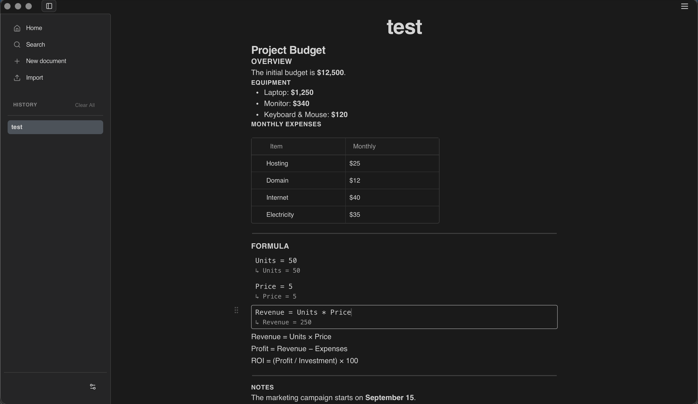
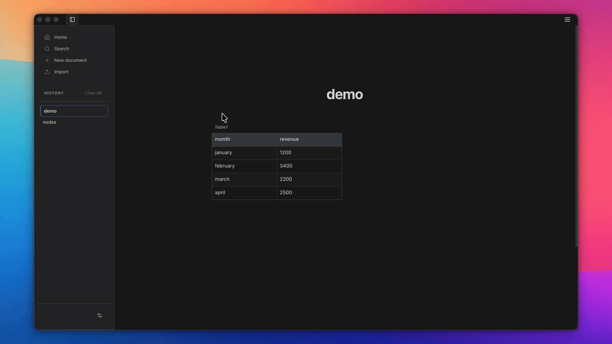

<p align="center">
  
</p>

<h1 align="center">ANQL</h1>

<p align="center">
  <a href="README.md">English</a> | <a href="README.fr.md">Français</a>
</p>

<p align="center">
  <a href="https://github.com/anqlproject/anql/releases/latest">
    
  </a>
  
  
  
</p>

<p align="center">
  <a href="#à-propos-danql">À propos</a> |
  <a href="#fonctionnalités">Fonctionnalités</a> |
  <a href="#télécharger"><strong>Télécharger</strong></a> |
  <a href="#prise-en-main">Démarrer</a>
  <br />
  <a href="#détails-techniques">Technique</a> |
  <a href="#communauté">Communauté</a>
</p>

<br />



---

## À propos d’ANQL

### Principes fondamentaux

ANQL repose sur trois principes :

- **Commencer simplement :** écrire ne devrait jamais nécessiter un modèle de base de données ni une étape de configuration.
- **N’ajouter de la complexité que si nécessaire :** les tableaux, calculs et graphiques sont disponibles lorsqu’ils aident à développer une idée.
- **Garder le raisonnement avec les données :** réunir les notes, calculs et visualisations dans un même document local.

### À qui s’adresse ANQL ?

ANQL s’adresse aux personnes qui veulent organiser leurs idées sans être contraintes d’utiliser un tableur, une base de données complexe ou un environnement de programmation.

- **Étudiants et chercheurs :** prendre des notes naturellement, organiser des données dans des tableaux, effectuer des calculs avec les blocs Math et visualiser les résultats avec des graphiques, le tout dans un seul document.
- **Toute personne qui travaille avec des données et des calculs :** commerçants, travailleurs indépendants, analystes financiers et bien d’autres.

### Pourquoi ANQL ?

- **Excel** est excellent pour les analyses avancées.
- **Notion** est excellent pour la collaboration et les bases de données partagées.
- **Jupyter Notebook** est excellent pour les calculs basés sur du code.

ANQL s’adresse à ce qui se trouve avant ou entre ces outils : la liberté de prendre de simples notes, avec davantage de possibilités lorsque vous en avez besoin.

---

## Fonctionnalités

- **Écriture simple :** rédiger, mettre en forme avec des raccourcis Markdown et styliser du texte sélectionné.
- **Création intelligente :** saisir « table », « csv » ou « h2 » sur une nouvelle ligne, puis appuyer sur `TAB` pour créer instantanément l’élément correspondant.
- **Import et export CSV :** importer des fichiers `.csv` dans des tableaux structurés et exporter n’importe quel tableau en CSV en un clic.
- **Rapide, local et hors ligne :** SQLite conserve vos données rapidement et de façon fiable, sans connexion Internet.
- **Recherche en texte intégral :** retrouver instantanément une information dans tous vos documents.
- **Références réutilisables :** enregistrez textes, code, formules, images ou PDF pour les réutiliser dans vos documents avec `@nom` ou par glisser-déposer. Téléchargez des collections prêtes à l’emploi.
- **Apparence claire, sombre ou système :** choisir un thème fixe ou suivre les réglages d’apparence du système d’exploitation.
- **Import et export :** ouvrir et enregistrer des documents au format Markdown ou au format natif `.anql` — une archive ZIP contenant le JSON du document et tous ses fichiers intégrés.
- **Tableaux, calculs et graphiques :** combiner des données structurées, des calculs et des visualisations dans un même document.

<p align="center">
  
</p>

---

## Prise en main

### Télécharger

ANQL est disponible sous forme d’application de bureau autonome pour **macOS, Windows et Linux**.

| Plateforme | Format / architecture | Téléchargement direct |
|---|---|---|
| **macOS** | Apple Silicon (`.dmg`)<br>Intel (`.dmg`) | [**Télécharger pour macOS (Apple Silicon)**](https://github.com/anqlproject/anql/releases/latest/download/ANQL_0.5.0_aarch64.dmg)<br>[**Télécharger pour macOS (Intel)**](https://github.com/anqlproject/anql/releases/latest/download/ANQL_0.5.0_x64.dmg) |
| **Windows** | Installateur 64 bits (`.exe`)<br>Windows MSI (`.msi`) | [**Télécharger pour Windows (.exe)**](https://github.com/anqlproject/anql/releases/latest/download/ANQL_0.5.0_x64-setup.exe)<br>[**Télécharger pour Windows (.msi)**](https://github.com/anqlproject/anql/releases/latest/download/ANQL_0.5.0_x64_en-US.msi) |
| **Linux** | AppImage universel (`.AppImage`)<br>Debian / Ubuntu (`.deb`) | [**Télécharger pour Linux (.AppImage)**](https://github.com/anqlproject/anql/releases/latest/download/anql_0.5.0_amd64.AppImage)<br>[**Télécharger pour Linux (.deb)**](https://github.com/anqlproject/anql/releases/latest/download/anql_0.5.0_amd64.deb) |

Consultez tous les [fichiers disponibles sur la page des versions GitHub](https://github.com/anqlproject/anql/releases).

### Avertissement de sécurité macOS

ANQL n’étant pas encore signé et notarié avec un certificat Apple Developer, macOS peut bloquer l’application téléchargée. Si vous faites confiance à la source du téléchargement :

1. Ouvrez le fichier `.dmg` téléchargé ou l’application dans le Finder.
2. Faites un clic droit sur **ANQL**, puis choisissez **Ouvrir**.
3. Confirmez en cliquant sur **Ouvrir** dans la fenêtre d’avertissement.

Si macOS bloque toujours l’application, vous pouvez retirer l’attribut de quarantaine de l’application téléchargée dans Terminal :

```bash
xattr -dr com.apple.quarantine "/Applications/ANQL.app"
```

Ouvrez ensuite ANQL normalement depuis le dossier **Applications**. N’exécutez cette commande que pour une application provenant d’une source à laquelle vous faites confiance.

### Compiler depuis les sources

**Prérequis**
- Node.js 18 ou version ultérieure et npm
- Rust et Cargo (pour Tauri)
- macOS 11 ou version ultérieure (Big Sur), Windows 10 ou version ultérieure, ou une distribution Linux récente

```bash
# Cloner le dépôt
git clone https://github.com/anqlproject/anql.git
cd anql

# Installer les dépendances
npm install

# Lancer en mode développement
npm run tauri dev

# Compiler pour la production
npm run tauri build
```

---

## Dépannage

**Problèmes fréquents**

- **Échec de compilation :** vérifiez que Node.js 18 ou une version ultérieure et Rust sont installés.
- **Tauri plante en mode développement :** essayez de vider le cache avec `rm -rf src-tauri/target`.

Pour obtenir de l’aide, consultez les [issues GitHub](https://github.com/anqlproject/anql/issues) ou rejoignez notre [serveur Discord](https://discord.gg/z5Jgg9m83).

---

## Détails techniques

### Technologies utilisées

| Couche | Technologie |
|---|---|
| Application de bureau | [Tauri](https://tauri.app/) |
| Interface utilisateur | [React](https://react.dev/) |
| Gestion d’état | [Zustand](https://zustand-demo.pmnd.rs/) |
| Moteur d’édition | [Lexical](https://lexical.dev/) |
| Moteur de calcul | [mathjs](https://mathjs.org/) |
| Graphiques | [Chart.js](https://www.chartjs.org/) |
| Base de données | [SQLite](https://www.sqlite.org/) |

## Communauté

Vous avez des commentaires, trouvé un bug ou une idée à proposer ?

💬 [Rejoignez notre serveur Discord](https://discord.gg/z5Jgg9m83) — vos retours sont les bienvenus.

🐛 [Signalez un bug ou proposez une fonctionnalité](https://github.com/anqlproject/anql/issues)

Suivez-nous sur [X / Twitter](https://x.com/anqlproject) pour rester informé.

---

## Licence

Ce projet est distribué sous licence MIT. Consultez le fichier [LICENSE](LICENSE) pour plus de détails.
